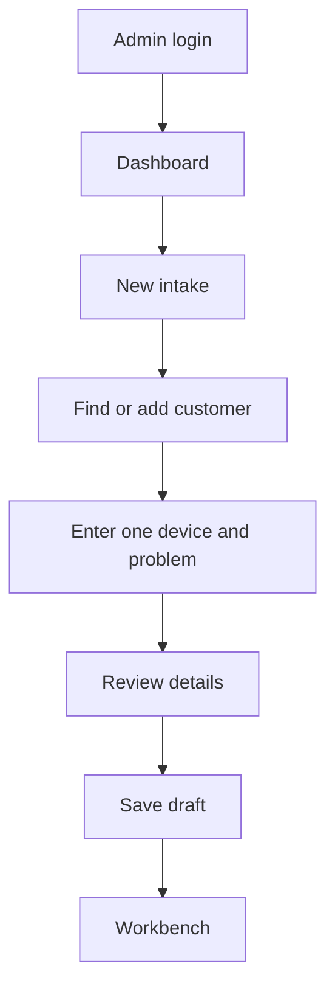

# RepairTrack: Current System and Simplified Plan

**Status date:** 2026-10-28  
**Repository branch:** `feature/simple-foundation`

This document separates what currently works in the consolidated PHP app, what the browser prototype demonstrates, and what is only proposed for the simpler rebuild. The new simplified database and application have not been implemented yet.

## 1. Current PHP system

The PHP app is a local learning build using PHP 8.1+, MySQL, and PDO. Its working path is a staff member signing in as an administrator, opening the dashboard, and saving a repair intake as a draft.

When the draft is saved, the app writes a new customer and contact if needed, then a draft ticket, one device row, and an audit event in one database transaction. It does not issue a customer tracking code or begin repair work.

### Current PHP features

- Administrator login with hashed-password verification, CSRF checks, session renewal, and idle-session expiry.
- One-use password reset links that expire after 30 minutes. The password reset table is installed separately with `database/password_reset.sql`.
- Dashboard counts, a short workbench queue, customer totals, and repair-status counts.
- Three-step intake: customer matching, one device and reported problem, then a review before saving a draft.
- Public landing page and responsive UI.
- A wireframe that describes future customer and staff screens.

### Current source layout

| Path | Responsibility |
|---|---|
| `app/db.php` | Makes the PDO connection from the ignored local configuration file. |
| `app/auth.php` | Admin session, login, CSRF, and access checks. |
| `app/dashboard_data.php` | Dashboard queries and labels. |
| `admin/` | Request handlers and screens for login, recovery, dashboard, and intake. |
| `app/intake/rules.php` | Intake defaults, input handling, and server-side validation. |
| `app/intake/repository.php` | Intake queries and the transaction that saves a draft. |
| `views/intake/create.php` | Intake HTML template. |
| `database/schema.sql` | Current 32-table starter schema. |
| `database/password_reset.sql` | Optional password reset table for an existing database. |
| `demo-prototype/` | Separate browser-only simulation; it does not call the PHP app. |

### Current database

The starter schema creates 32 tables. Several describe future workflows and are not used by current PHP screens. Password recovery adds one more table when its separate SQL file is applied.

| Area | Tables in the current starter schema |
|---|---|
| Branches, staff, customers, tickets | `branches`, `users`, `user_branch_assignments`, `customers`, `customer_contacts`, `customer_devices`, `storage_locations`, `repair_tickets`, `ticket_devices` |
| Intake evidence and corrections | `ticket_accessory_items`, `ticket_device_photos`, `ticket_device_acknowledgments`, `ticket_intake_gate_events`, `ticket_correction_notes` |
| Status and custody | `ticket_status_events`, `device_transfers`, `device_transfer_items`, `device_custody_events`, `ticket_operational_events` |
| Parts and inventory | `parts`, `branch_inventory`, `inventory_transfers`, `inventory_transfer_items`, `inventory_transactions`, `ticket_parts_used` |
| Quotes and bills | `repair_quotes`, `repair_quote_items`, `repair_quote_decisions`, `repair_bills`, `repair_bill_items` |
| System history | `mock_notification_log`, `audit_events` |

The current schema uses MySQL `ENUM` values for roles, repair statuses, custody, transfer states, and event types. That makes adding a new state a schema change. The schema is broad compared with the current PHP behavior: for example, it includes quote, bill, inventory, and custody tables, but those workflows are not yet connected to real PHP operations.

## 2. Browser prototype

The prototype under `demo-prototype/` illustrates a longer workflow: customer tracking, technician diagnosis and quotes, customer approval, repair and testing, cash billing, handover, inventory, transfers, and reports.

All prototype data is fictional and saved in browser-local storage. Role switching is a demonstration control, not authentication or authorization. The prototype does not write to MySQL, send notifications, take digital payments, or run real staff permissions.

## 3. Comparison

| Concern | Current PHP app | Browser prototype | Simplified system (planned) |
|---|---|---|---|
| Purpose | Working admin login, dashboard, and intake draft | Demonstrates the full intended journey | Real PHP/MySQL workflows, implemented in phases |
| Data storage | MySQL through PDO | Browser-local sample data | New clean database, `repairtrack_simple`; leave the old database untouched |
| Login and roles | Admin authentication only | Switchable sample roles | Server-checked staff roles and branch access |
| Intake | One device per saved draft | Multi-device example flows | Intake and tracking built first; decide each table only when its workflow is implemented |
| Repair status | Values exist in schema; limited current PHP use | Simulated technician status changes | Status choices stored as data, with a history row for each change |
| Customer tracking | No issued public code or live status page yet | Simulated tracking and customer actions | Add real customer-safe tracking as a feature |
| Quotes and bills | Tables exist, no complete PHP workflow | Simulated approval and cash billing | Implement after the repair flow; keep cash/COD separate from repair status |
| Inventory and transfers | Many tables exist, no complete PHP workflow | Simulated stock and custody | Defer until the core workflow works |
| Notifications and activity | Mock notification table and audit event table | Simulated messages and notices | Keep internal activity separate from customer-visible updates and scope recipients |
| Reports | Limited dashboard counts and a status summary | Sample reports | Derive reports from real recorded data; add after the workflows they depend on |

## 4. Planned simpler structure

The simplified version will use a new empty database because the chosen approach is to start fresh. The existing `repairtrack` database and current schema remain as reference; the new setup must not drop or rewrite them.

The first foundation should support only the shared records needed to start a repair: branches, staff and branch assignments, customers and contacts, tickets, devices, configurable repair statuses, and status history. Later branches can add custody, quotes and cash, scoped notifications/activity, and reports. Inventory and other optional areas are added when their workflow is ready.

The design rules are:

- Keep tables for meaningful relationships, such as a ticket having multiple devices.
- Store changeable repair status choices in a small lookup table instead of a hard-coded enum.
- Record each status change with its actor, time, and customer-visibility choice.
- Keep request handling, validation, database writes, and page templates in separate, plainly named files.
- Use ordinary PHP functions and PDO statements. Comments should explain business rules and the file to edit when a rule changes.
- Do not build generic factories, a large framework layer, or flexible JSON blobs for ordinary ticket fields.
- Treat prototype role switching, sample PINs, and sample data as presentation aids only.

## 5. Branch plan

All new work stays off `main`. `System-Consolidation` keeps the merged prior work. `Simplified-System` is the proposed parent for the rebuild. The feature branches are starting points and should be worked through one at a time, with reviewable PRs back to `Simplified-System`.

1. `feature/simple-foundation`: fresh database, PDO setup, core tables, and starter data.
2. `feature/simple-intake-tracking`: customer search, intake, ticket/device creation, and customer tracking.
3. `feature/simple-repair-custody`: repair progression and confirmed device location/custody.
4. `feature/simple-quotes-cash`: quote approval, bills, cash, and COD records.
5. `feature/simple-access-activity`: server-side staff/branch access, internal activity, and scoped notifications.
6. `feature/simple-reports`: reports based on the workflows above.

The feature branches currently start from the same `Simplified-System` baseline. They are not merged or sequenced yet; open and review their PRs in dependency order so the same files and schema are not changed in parallel.

## 6. What remains undecided

The user has chosen a fresh database and a phased implementation of the full prototype scope. Exact staff permissions, which repair-status choices should be editable by admins, and what customer updates are safe to show should be decided when those features are implemented. Until then, the comparisons above describe the current code and mark the new system as a plan.
